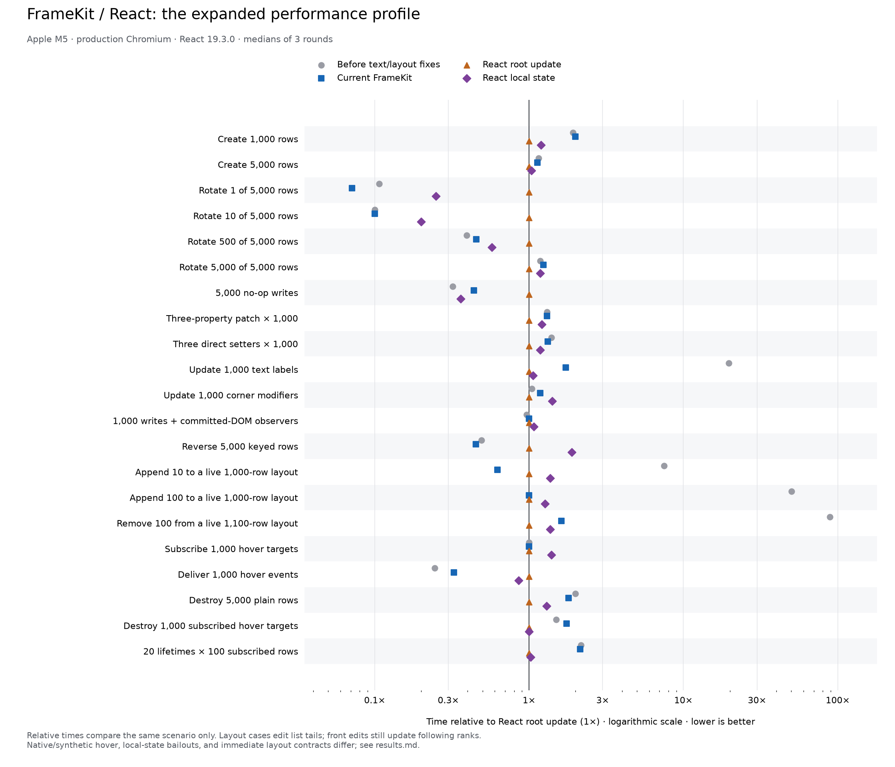

# Expanded production comparison

This isolated package compares FrameKit with pinned React 19.3.0 without adding React to the
library or Playground dependencies. It measures 21 scenarios: bulk creation, sparse/dense/no-op
writes, grouped patches, text, modifiers, observers, keyed reversal, live-layout insertion/removal,
hover, subscribed teardown, and repeated lifetimes.

Run from the repository root with its development dependencies and Playwright Chromium installed.

```sh
npm ci --prefix benchmarks/comparison
node benchmarks/comparison/run.mjs
```

The runner builds both versions in production mode, serves them on an ephemeral local port,
checks geometry/identity/notifications/cleanup, and writes [results.json](results.json) and
[results.md](results.md). The default baseline is `846fd1c`, immediately before the text and incremental-layout
optimizations. It must be present in local Git history. Useful options:

```sh
node benchmarks/comparison/run.mjs --baseline 846fd1c --rounds 3 --repetitions 7
node benchmarks/comparison/run.mjs --cpu-throttle 4 --out /tmp/comparison.json
node benchmarks/comparison/run.mjs --cases text --baseline 846fd1c --out /tmp/text.json
```

The reports explain the differences between React root updates and per-row state, immediate
FrameKit layout updates and batched React commits, and FrameKit native versus React synthetic
hover delivery. Timings include layout where relevant and exclude paint. They are diagnostics,
not CI timing budgets or full-application rankings.

To regenerate the standalone chart with Python and Matplotlib:

```sh
python3 benchmarks/comparison/plot.py benchmarks/comparison/results.json \
  --output benchmarks/comparison/comparison
```



The matrix intentionally retains unfavorable cases. Its live-list edits add/remove rows at the tail.
Edits near the front still update following CSS order ranks; changes to sorting, layout settings, or
explicit child order rebuild layout output. Construction, text rendering, and repeated lifetimes
still include FrameKit feature overhead. See the report for measured differences and limitations.
