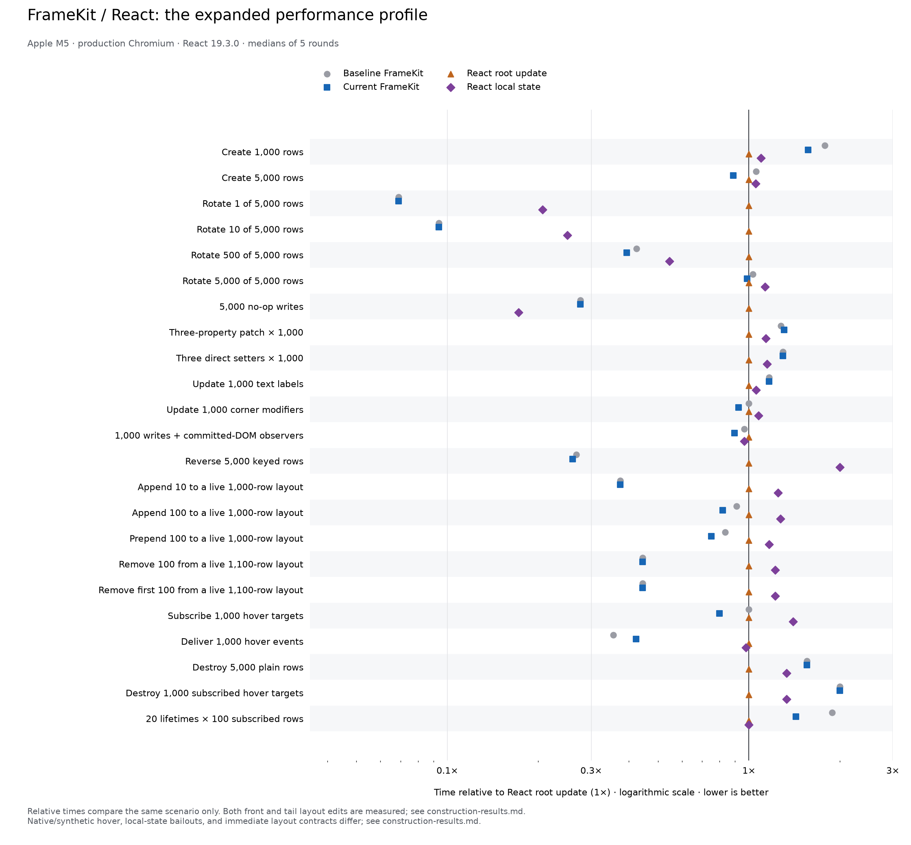

# Frame construction performance investigation

Baseline: `b1f67fee64cb0e68c4443803252fc2f5746d045e` (`b1f67fe`). Final library source:
`dd457ef01fae8b540e6c0410f93b0a034573280d`; clean source tree. Measured 2026-10-14T03:37:32.684Z.
Apple M5, production Chromium 156.0.8078.4,
React 19.3.0, CPU throttle 1×.

## Retained optimization

`d232367` prepares the default Frame once per document and semantic tag using the existing
renderer, then clones its detached native element and style snapshots. Each live Frame still
gets its own handle, property state, hierarchy, listeners, and writable style records. Initial
GUI CSS now goes through the existing style owner, so unchanged native declarations can be
reused. The optimization applies to Frame construction; text/image hosts keep their constructors.

`dd457ef` restores unconditional base-style assignments in the shared style writer. The rendered
cache still skips unchanged native CSS. This removes an extra comparison from every later
base update while retaining the construction gain. Properties and edits remain synchronous;
there is no public API change, batching, or deferred rendering.

## Final matched matrix

- Create 1,000 rows: **7.5 → 6.6 ms (12.0% less time)**.
- Create 5,000 rows: **33.9 → 28.5 ms (15.9% less time)**.
- 20 lifetimes × 100 subscribed rows: **17.0 → 12.9 ms (24.1% less time)**.

21 of 23 medians were equal or lower. Higher medians remain visible:
patch 3.7 → 3.8 ms, hover-dispatch 1.6 → 1.9 ms.
These measurements do not establish a zero-cost change for every operation. Small deltas,
especially fractions of a millisecond, overlap the variation seen in the focused/control runs.
The main repeatable improvement is construction and repeated lifetimes. Hover delivery still
measured 1.6 → 1.9 ms (+18.8%), and no-op/small-append p95 increased. These remaining
tail differences are unresolved diagnostics; this is not a blanket regression-free claim.

Milliseconds, lower is better. Medians are the median of five round medians, with 11 measured
repetitions after two warmups per round. p95 pools 55 samples. Version order alternates;
runtime scheduling rotates; each version/runtime has a fresh page per round. Percentages
compare elapsed time, not throughput. p95 estimates are diagnostics, not confidence intervals.

| Scenario                                      | Before FK | Final FK | Median change | p95 before → final | React root | React local |
| --------------------------------------------- | --------: | -------: | ------------: | -----------------: | ---------: | ----------: |
| Create 1,000 rows                             |       7.5 |      6.6 |        -12.0% |          9.0 → 7.2 |        4.2 |         4.6 |
| Create 5,000 rows                             |      33.9 |     28.5 |        -15.9% |        43.5 → 37.2 |       32.1 |        33.8 |
| Rotate 1 of 5,000 rows                        |       0.2 |      0.2 |         +0.0% |          0.9 → 0.8 |        2.9 |         0.6 |
| Rotate 10 of 5,000 rows                       |       0.3 |      0.3 |         +0.0% |          1.1 → 1.1 |        3.2 |         0.8 |
| Rotate 500 of 5,000 rows                      |       1.4 |      1.3 |         -7.1% |          2.5 → 1.7 |        3.3 |         1.8 |
| Rotate 5,000 of 5,000 rows                    |       7.0 |      6.7 |         -4.3% |         10.4 → 7.8 |        6.8 |         7.7 |
| 5,000 no-op writes                            |       0.8 |      0.8 |         +0.0% |          1.9 → 4.0 |        2.9 |         0.5 |
| Three-property patch × 1,000                  |       3.7 |      3.8 |         +2.7% |          4.4 → 4.3 |        2.9 |         3.3 |
| Three direct setters × 1,000                  |       3.5 |      3.5 |         +0.0% |          3.9 → 3.9 |        2.7 |         3.1 |
| Update 1,000 text labels                      |       4.2 |      4.2 |         +0.0% |          5.4 → 4.7 |        3.6 |         3.8 |
| Update 1,000 corner modifiers                 |       2.6 |      2.4 |         -7.7% |          2.9 → 2.8 |        2.6 |         2.8 |
| 1,000 writes + committed-DOM observers        |       2.8 |      2.6 |         -7.1% |          3.1 → 2.8 |        2.9 |         2.8 |
| Reverse 5,000 keyed rows                      |       7.3 |      7.1 |         -2.7% |         10.7 → 7.8 |       27.3 |        54.7 |
| Append 10 to a live 1,000-row layout          |       0.3 |      0.3 |         +0.0% |          0.9 → 1.8 |        0.8 |         1.0 |
| Append 100 to a live 1,000-row layout         |       1.0 |      0.9 |        -10.0% |          1.6 → 1.4 |        1.1 |         1.4 |
| Prepend 100 to a live 1,000-row layout        |       1.0 |      0.9 |        -10.0% |          1.6 → 1.5 |        1.2 |         1.4 |
| Remove 100 from a live 1,100-row layout       |       0.4 |      0.4 |         +0.0% |          0.6 → 0.6 |        0.9 |         1.1 |
| Remove first 100 from a live 1,100-row layout |       0.4 |      0.4 |         +0.0% |          0.7 → 0.7 |        0.9 |         1.1 |
| Subscribe 1,000 hover targets                 |       0.5 |      0.4 |        -20.0% |          0.6 → 0.5 |        0.5 |         0.7 |
| Deliver 1,000 hover events                    |       1.6 |      1.9 |        +18.8% |          2.9 → 3.3 |        4.5 |         4.4 |
| Destroy 5,000 plain rows                      |       1.4 |      1.4 |         +0.0% |          7.9 → 1.8 |        0.9 |         1.2 |
| Destroy 1,000 subscribed hover targets        |       0.6 |      0.6 |         +0.0% |          0.8 → 0.7 |        0.3 |         0.4 |
| 20 lifetimes × 100 subscribed rows            |      17.0 |     12.9 |        -24.1% |        24.3 → 15.0 |        9.0 |         9.0 |



The React comparisons for the changed workloads are:

- Create 1,000 rows: 57.1% more time than React root; 43.5% more time than React local.
- Create 5,000 rows: 11.2% less time than React root; 15.7% less time than React local.
- 20 lifetimes × 100 subscribed rows: 43.3% more time than React root; 43.3% more time than React local.

There is no workload-independent overall winner. Sparse updates, keyed reversal, and live
layout edits remain useful FrameKit cases; smaller construction, ordinary text, no-op local
state, and teardown still expose gaps. React root renders keyed rows from root state; React
local uses per-row state. Both receive one flushSync per operation. FrameKit commits individual
writes immediately. Observer/resource cases require per-row effects in both React variants.
Hover compares programmatic native and synthetic dispatch, not real pointer-to-paint latency.

## First-use and maintenance costs

A separate diagnostic used 31 fresh pages per version, alternating order, with isolated contexts
for precise timers. It measured the first default Frame, the first article Frame, and then
100 subsequent detached create/destroy lifetimes. It excludes layout, paint, and the React
fixture, so its numbers are separate from the matrix.

| Detached diagnostic            |   Before |    Final |
| ------------------------------ | -------: | -------: |
| First default Frame            | 0.400 ms | 0.535 ms |
| First article Frame after that | 0.045 ms | 0.060 ms |
| 100 subsequent lifetimes       | 0.850 ms | 0.660 ms |

The lazy first template adds about **0.135 ms** to that first Frame. The cache retains
one detached prototype plus private style snapshots per used document/tag, up to the ten
supported Frame tags. The document key is weak. Retained memory was not measured.

The new maintenance rule lives in the style owner: snapshots stay private and unchanged;
instance records shadow defaults, including explicit undefined shadows when removing an
inherited value. Native CSS and its rendered cache are captured together. Tests protect removal,
layer restoration, failed-write retries, independent instances/documents/tags, and destruction.
Default CSS is still derived from the existing renderer, avoiding a second hand-maintained policy.

## Regression investigation and rejected variants

The first implementation copied full style dictionaries per instance. It slowed the focused
5,000-row case from 33.2 to 34.4 ms and lifetimes from 16.6 to 17.2 ms, so it was discarded.
Private inherited snapshots avoid those per-instance copies.

The initial conditional base-write version (`d232367`) showed small increases in direct setters,
corners, observers, and hover, plus a teardown p95 spike. Five-round × 31-repetition checks
and identical-source controls investigated them; these are precursor results, not the final
source's matrix. The teardown spike did not repeat, while direct setters/corners warranted
removing the extra base-value comparison. Variation alone was not taken as proof of no cost.

| Precursor case | Before → conditional median | Before → conditional p95 | Identical-source median A → B |
| -------------- | --------------------------: | -----------------------: | ----------------------------: |
| separate       |                   3.1 → 3.6 |                3.9 → 3.9 |                     3.5 → 3.6 |
| corner         |                   2.4 → 2.6 |                3.8 → 3.6 |                     2.6 → 2.6 |
| observed       |                   2.6 → 2.5 |                4.7 → 4.3 |                     2.7 → 2.6 |
| hover-dispatch |                   3.2 → 3.6 |                5.2 → 5.7 |                     4.2 → 4.4 |
| destroy        |                   1.5 → 1.6 |                2.3 → 2.2 |                     1.5 → 1.5 |

The unconditional-write focused run retained the construction/lifetime gain; the final full
matrix above was then rerun from clean `dd457ef`. Earlier raw runs, controls, and the final cold
diagnostic are preserved in [construction-diagnostics.json](construction-diagnostics.json).
The cold diagnostic was a one-off script at `/tmp/framekit-cold.mjs`; it is not a maintained
runner entry point. Its timer isolation, order, environment, and all samples are recorded.

## Validation and reproduction

58 affected unit cases passed. Chromium covered affected text, layout mutations, focus, runtime,
and cleanup; the new Frame isolation case passed in Chromium, Firefox, and WebKit. After the
style-write simplification, 12 style/Frame cases, the Chromium isolation case, and TypeScript
passed again. Commit hooks passed. All 23 benchmark fixture assertions completed, including
geometry, identity, notifications, and owned cleanup. Before/final compatibility audits match.
The complete unit/build/browser matrix remains in CI.

```sh
node benchmarks/comparison/run.mjs --baseline b1f67fe --rounds 5 --repetitions 11 --out benchmarks/comparison/construction-results.json
python3 benchmarks/comparison/plot.py benchmarks/comparison/construction-results.json --output benchmarks/comparison/construction-comparison
```

The runner emits its standard report; this file adds the construction-specific interpretation.
Raw samples, source revisions, methodology, compatibility audits, and harness fingerprint are in
[construction-results.json](construction-results.json). Geometry-changing cases force layout;
paint, hydration, network, mobile hardware, memory retention, and full application responsiveness
are outside this matrix. React Compiler is disabled. Historical [text/style results](followup-results.md)
and [DOM-order audit](regression.md) remain unchanged.
