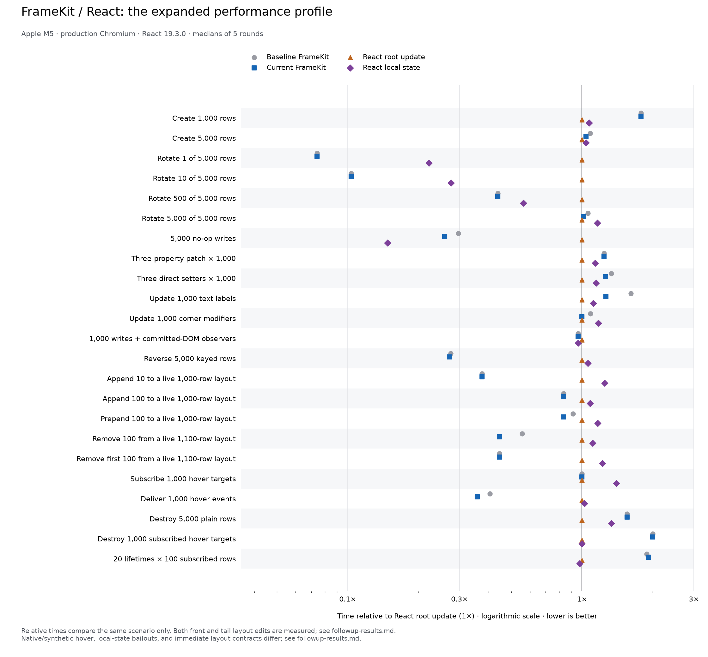

# Text/style follow-up performance investigation

Source baseline: `a48fd6462d01be959d60f9f80a1cb69e40fecd59` (`a48fd64`, before this follow-up).
Current library source: `c4fc54aad461ad61c25390bf2e0731af806caba9`. Measured 2026-10-14T02:24:17.054Z.
Apple M5, production Chromium 156.0.8078.4,
React 19.3.0, CPU throttle 1×.

## Retained changes

- `4103249`: initialize gradient/outline defaults once in the base style layer. Text edits had
  reset native CSS behind the style cache, making unchanged effects disappear. Four regression
  tests reproduced that failure before the fix; Chromium verifies computed paint and outline.
  This also removes five redundant effect-reset writes per typography update.
- `e86b871`: mirror outline font/alignment geometry through the existing style cache. Unchanged
  typography avoids native CSS writes, and style-owner overrides survive edits and restore the
  latest base geometry on removal. No new cache or deferred work is introduced.
- `f7c8b5e`: share a frozen empty record for derived style layers. This removes three empty-record
  allocations per new element plus empty-reconciliation allocations. Base/fallback/rendered
  records remain independent. The isolated timing run was nearly flat for lifecycle churn
  (16.3 → 16.2 ms), so allocation reduction is established without claiming a large speedup.

## Matched full matrix

The main measured gain is ordinary text updating: 5.5 → 4.3 ms (21.8% less time), with p95
6.1 → 4.9 ms. Of 23 scenarios, 22 medians were equal or lower. Repeated subscribed lifetimes
were 17.0 → 17.3 ms (+1.8%); no meaningful lifecycle speedup is claimed. The current text case
still takes 13–26% more time than React local/root state, and repeated lifetimes remain roughly
twice React's time. The full table retains these gaps and the higher tail timings.

All values are milliseconds; lower is better. Medians are the median of five round medians,
with 11 measured repetitions per round after two warmups. p95 pools the 55 samples. Each
version/runtime gets a fresh page per round; version order alternates and runtime scheduling
rotates. Negative changes mean less elapsed time, not a throughput increase. Sub-millisecond
percentages and p95 values are noisy diagnostics, not confidence intervals.

| Scenario                                      | Before FK | Current FK | Median change | p95 before → current | React root | React local |
| --------------------------------------------- | --------: | ---------: | ------------: | -------------------: | ---------: | ----------: |
| Create 1,000 rows                             |       7.5 |        7.5 |         +0.0% |            8.5 → 8.9 |        4.2 |         4.5 |
| Create 5,000 rows                             |      35.3 |       33.9 |         -4.0% |          43.4 → 41.6 |       32.6 |        33.9 |
| Rotate 1 of 5,000 rows                        |       0.2 |        0.2 |         +0.0% |            0.3 → 0.4 |        2.7 |         0.6 |
| Rotate 10 of 5,000 rows                       |       0.3 |        0.3 |         +0.0% |            1.0 → 1.0 |        2.9 |         0.8 |
| Rotate 500 of 5,000 rows                      |       1.4 |        1.4 |         +0.0% |            1.8 → 1.8 |        3.2 |         1.8 |
| Rotate 5,000 of 5,000 rows                    |       7.1 |        6.8 |         -4.2% |            8.2 → 7.9 |        6.7 |         7.8 |
| 5,000 no-op writes                            |       0.8 |        0.7 |        -12.5% |            1.1 → 1.3 |        2.7 |         0.4 |
| Three-property patch × 1,000                  |       3.6 |        3.6 |         +0.0% |            4.2 → 3.8 |        2.9 |         3.3 |
| Three direct setters × 1,000                  |       3.6 |        3.4 |         -5.6% |            4.1 → 3.9 |        2.7 |         3.1 |
| Update 1,000 text labels                      |       5.5 |        4.3 |        -21.8% |            6.1 → 4.9 |        3.4 |         3.8 |
| Update 1,000 corner modifiers                 |       2.5 |        2.3 |         -8.0% |            3.0 → 2.8 |        2.3 |         2.7 |
| 1,000 writes + committed-DOM observers        |       2.6 |        2.6 |         +0.0% |            3.1 → 2.9 |        2.7 |         2.6 |
| Reverse 5,000 keyed rows                      |       7.6 |        7.5 |         -1.3% |            9.6 → 8.8 |       27.6 |        29.2 |
| Append 10 to a live 1,000-row layout          |       0.3 |        0.3 |         +0.0% |            0.9 → 1.2 |        0.8 |         1.0 |
| Append 100 to a live 1,000-row layout         |       1.0 |        1.0 |         +0.0% |            1.4 → 1.6 |        1.2 |         1.3 |
| Prepend 100 to a live 1,000-row layout        |       1.1 |        1.0 |         -9.1% |            1.7 → 1.5 |        1.2 |         1.4 |
| Remove 100 from a live 1,100-row layout       |       0.5 |        0.4 |        -20.0% |            0.7 → 0.6 |        0.9 |         1.0 |
| Remove first 100 from a live 1,100-row layout |       0.4 |        0.4 |         +0.0% |            0.7 → 0.7 |        0.9 |         1.1 |
| Subscribe 1,000 hover targets                 |       0.5 |        0.5 |         +0.0% |            0.6 → 0.6 |        0.5 |         0.7 |
| Deliver 1,000 hover events                    |       1.7 |        1.5 |        -11.8% |            3.2 → 1.9 |        4.2 |         4.3 |
| Destroy 5,000 plain rows                      |       1.4 |        1.4 |         +0.0% |            1.6 → 2.0 |        0.9 |         1.2 |
| Destroy 1,000 subscribed hover targets        |       0.6 |        0.6 |         +0.0% |            0.9 → 0.9 |        0.3 |         0.3 |
| 20 lifetimes × 100 subscribed rows            |      17.0 |       17.3 |         +1.8% |          24.9 → 25.1 |        9.0 |         8.8 |



The full run retains unfavorable cases and small positive deltas. Do not attribute every change
to an optimization: identical-source controls in the earlier audit showed substantial variation.
FrameKit still commits individual changes synchronously; React uses one flushSync per operation.
Geometry-changing cases force layout. Paint, memory retention, hydration, mobile hardware,
other browsers, and full application responsiveness are not measured. React Compiler is disabled.

## What profiling established

One-off instrumented captures placed trace markers around the same scenario operations, sampled
CPU at 100 µs, and recorded browser/V8 tracing. These timings include diagnostic overhead and
are separate from the uninstrumented matrix above.

- The reversal and small-append concern did not reproduce as a consistent instrumented increase:
  before/current medians were 7.7/7.6 ms and 0.3/0.3 ms. This does not prove a zero timing change.
- In the slowest current hover capture, **5.723 ms** elapsed and
  **2.356 ms** overlapped main-thread garbage collection, dominated by
  incremental marking/DOM embedder tracing. This establishes GC as a contributor to a spike;
  it does not prove that all earlier p95 differences were GC or that hover tails are fixed.
- Lifecycle CPU samples concentrated in initial native CSS writes, handle construction, layout,
  and GC. Pure teardown was already relatively small. The text samples exposed redundant
  outline geometry writes and effect resets, motivating the retained text changes.

The compact operation/GC windows and focused raw timing runs are in
[followup-diagnostics.json](followup-diagnostics.json). Full local captures are referenced there;
the temporary diagnostic script is `/tmp/profile-framekit.mjs`. CPU sampling produced negative
timestamp deltas in hover profiles, so weighted CPU percentages are deliberately omitted.

## Rejected experiments

- The single-listener signal shortcut (`38fdf79`) showed 2.6 → 3.1 ms hover delivery in the first
  focused run. A five-round × 51-repetition follow-up swung in the opposite direction with wide
  variation. `c4fc54a` restores the simpler implementation because no repeatable benefit was
  established; the nested-emission and original-error-identity tests remain.
- Defining all own property accessors with Object.defineProperties allocated an extra descriptor
  map and slowed construction/lifecycle cases in the focused run. The uncommitted experiment
  was discarded. Handles retain ordinary own accessors and their original construction path.

## Validation and reproduction

Focused checks passed for text, effects, style layers, layout mutation, signals, observers, and
native event cleanup. Chromium covered text paint/scaling, list/grid focus/geometry, hover
disposal, repeated lifetimes, and animation interruption. Type-check and commit hooks passed.
All 23 benchmark fixture assertions completed, including committed DOM, geometry, identity,
notification counts, and owned cleanup. The full unit/build/browser matrix remains in CI.

```sh
node benchmarks/comparison/run.mjs --baseline a48fd64 --rounds 5 --repetitions 11 --out benchmarks/comparison/followup-results.json
python3 benchmarks/comparison/plot.py benchmarks/comparison/followup-results.json --output benchmarks/comparison/followup-comparison
```

The runner writes its standard report; this investigation adds the profiling interpretation and
rejected experiments. Source revisions, raw samples, methodology, and harness fingerprint are
preserved in [followup-results.json](followup-results.json). Earlier DOM-order results and their
[regression audit](regression.md) remain unchanged.
