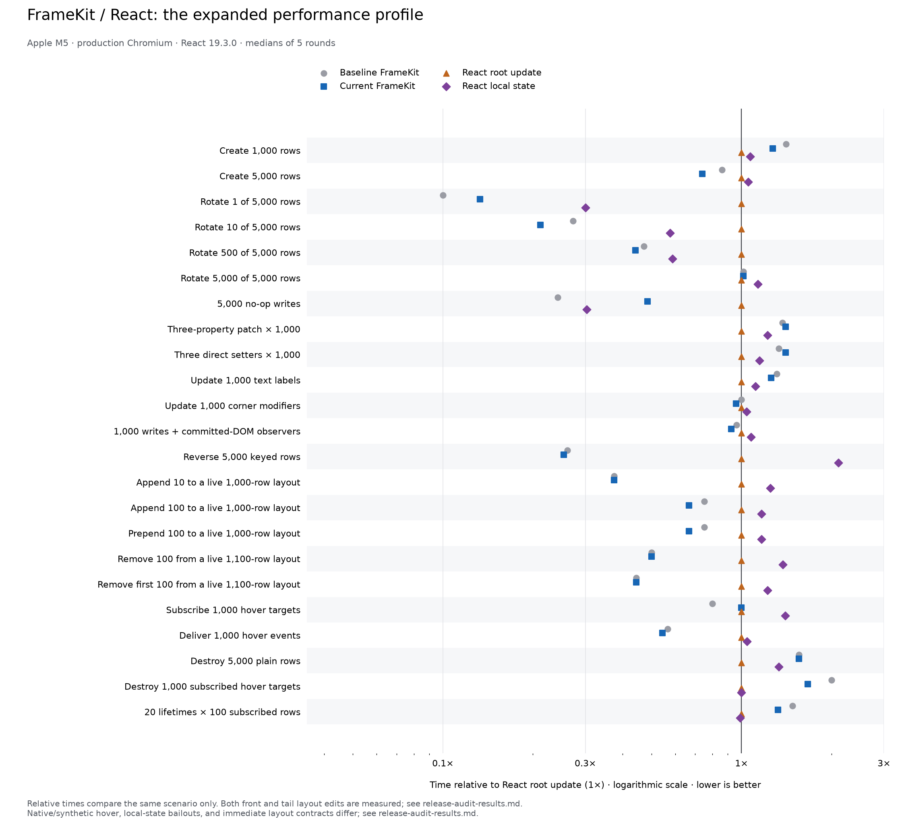

# Release security and performance review

Production changes: dependency update bc971f8, security hardening 2f7f1c4, prepared-Frame
optimization dfc1afd. Input-validation coverage was committed separately as b5798b2.
The main run captured dfc1afd plus that not-yet-committed test addition; production source was
identical to dfc1afd. The generated report preserves the dirty-source status and content hashes.

## Performance target

FrameKit is within 20% of React root in **16/23** scenarios, React local in **19/23**, and
**both in 15/23**. This is a threshold over medians in this production Chromium fixture, not a
full-application score or confidence interval. Milliseconds are lower-is-better; positive
percentages mean more elapsed time, not throughput. React root keeps keyed rows under root
state; React local uses per-row state.

| Scenario                                      | FrameKit ms | vs React root | vs React local |
| --------------------------------------------- | ----------: | ------------: | -------------: |
| Create 1,000 rows                             |         5.6 |        +27.3% |         +19.1% |
| Create 5,000 rows                             |        24.0 |        -26.2% |         -29.8% |
| Rotate 1 of 5,000 rows                        |         0.4 |        -86.7% |         -55.6% |
| Rotate 10 of 5,000 rows                       |         0.7 |        -78.8% |         -63.2% |
| Rotate 500 of 5,000 rows                      |         1.5 |        -55.9% |         -25.0% |
| Rotate 5,000 of 5,000 rows                    |         6.8 |         +1.5% |         -10.5% |
| 5,000 no-op writes                            |         1.6 |        -51.5% |         +60.0% |
| Three-property patch × 1,000                  |         3.8 |        +40.7% |         +15.2% |
| Three direct setters × 1,000                  |         3.8 |        +40.7% |         +22.6% |
| Update 1,000 text labels                      |         4.4 |        +25.7% |         +12.8% |
| Update 1,000 corner modifiers                 |         2.4 |         -4.0% |          -7.7% |
| 1,000 writes + committed-DOM observers        |         2.4 |         -7.7% |         -14.3% |
| Reverse 5,000 keyed rows                      |         7.2 |        -74.6% |         -87.9% |
| Append 10 to a live 1,000-row layout          |         0.3 |        -62.5% |         -70.0% |
| Append 100 to a live 1,000-row layout         |         0.8 |        -33.3% |         -42.9% |
| Prepend 100 to a live 1,000-row layout        |         0.8 |        -33.3% |         -42.9% |
| Remove 100 from a live 1,100-row layout       |         0.4 |        -50.0% |         -63.6% |
| Remove first 100 from a live 1,100-row layout |         0.4 |        -55.6% |         -63.6% |
| Subscribe 1,000 hover targets                 |         0.5 |         +0.0% |         -28.6% |
| Deliver 1,000 hover events                    |         2.5 |        -45.7% |         -47.9% |
| Destroy 5,000 plain rows                      |         1.4 |        +55.6% |         +16.7% |
| Destroy 1,000 subscribed hover targets        |         0.5 |        +66.7% |         +66.7% |
| 20 lifetimes × 100 subscribed rows            |        11.8 |        +32.6% |         +34.1% |

[Generated median/p95 timings](release-audit-results.md) and [raw samples](release-audit-results.json)
include all 23 cases, five rounds and 21 repetitions per series. Geometry changes force layout;
paint, mobile hardware, hydration and React Compiler are outside the measurement.

## Retained optimization and tradeoffs

Prepared Frames already have default DOM styles and style-cache state from their native template.
Creation now renders caller overrides rather than replaying every default and fixed base style.
Default and caller property validation still runs. The option is internal; public own accessors,
property/observer timing, native events, layout, animation interruption and cleanup contracts
are preserved. No runtime dependency or retained per-instance flag/cache was added.

In the full run, 1,000-row creation improved **6.2 → 5.6 ms** (9.7% less elapsed time),
5,000-row creation **28.0 → 24.0 ms** (14.3% less), and subscribed lifetimes
**13.2 → 11.8 ms** (10.6% less). Their p95 values also decreased. One thousand rows are now
19.1% slower than React local but 27.3% slower than React root; 5,000 rows are faster than
both. This does not achieve the 20% target everywhere.

Remaining gaps include grouped patches, plain teardown, subscribed teardown and repeated
lifetimes. FrameKit commits each edit synchronously and owns native per-element subscriptions;
React receives one flushSync per operation and uses delegated synthetic hover. Those contracts
explain some work differences but are not a complete attribution of the observed gap.
Per-node property creation, validation/copying and resource release remain candidate costs.
A bulk API or different handle representation would need a separate contract design and
measurements; do not silently remove validation or own-accessor behavior to meet a chart target.

## Rejected experiments

- Cached descriptor tables keyed by serialized property names slowed construction/lifetimes.
- Descriptor tables keyed by immutable factory defaults did not establish a useful gain.
- Skipping observer work for nodes without events showed inconsistent results.
- Selective text-outline geometry updates added branches without a useful repeatable gain.
- Selective typography validation measured 4.7 → 4.6 ms in an isolated five-round run; the
  small difference did not justify the additional code. Full typography validation remains.

All these production experiments were removed. Their diagnostic reports are retained in
release-audit-diagnostics.json; they are exploratory measurements, not universal speed claims.

## Regression investigation

The main run's no-op median increased **0.8 → 1.6 ms** while p95 stayed **3.8 → 3.7 ms**.
One-row rotation increased 0.3 → 0.4 ms and hover binding 0.4 → 0.5 ms. Patches/setters
rose 0.1/0.2 ms; reverse p95 rose 8.6 → 9.9 ms. These differences remain visible rather
than being described as regression-free. An identical-source control follows below.
The full matching-sequence control uses three rounds × 21 repetitions with **identical source
hashes** (308147a8eb81a349260c0e417fa207c5e267da29bae002c290352b11ab4ae49f). A focused control uses three rounds × 51 repetitions.

| Identical-source scenario          | Median A → B (ms) | p95 A → B (ms) |
| ---------------------------------- | ----------------: | -------------: |
| Create 1,000 rows                  |         5.6 → 5.6 |      6.4 → 6.6 |
| Create 5,000 rows                  |       24.0 → 23.6 |    34.3 → 34.0 |
| Rotate 1 of 5,000 rows             |         0.3 → 0.3 |      1.2 → 1.1 |
| 5,000 no-op writes                 |         1.2 → 1.0 |      3.1 → 3.7 |
| Three-property patch × 1,000       |         3.7 → 3.6 |      4.2 → 4.2 |
| Three direct setters × 1,000       |         3.9 → 3.5 |      4.1 → 4.5 |
| Update 1,000 text labels           |         4.4 → 4.4 |      5.3 → 5.0 |
| Reverse 5,000 keyed rows           |         7.1 → 7.1 |      7.5 → 8.0 |
| Subscribe 1,000 hover targets      |         0.4 → 0.5 |      0.6 → 0.6 |
| 20 lifetimes × 100 subscribed rows |       12.0 → 11.9 |    14.6 → 13.8 |

The 2× no-op median difference did not repeat in this full control. Hover binding still moved
0.4 → 0.5 ms with no code change, and setter medians moved 3.9 → 3.5 ms. Controls establish
material measurement variability; they do not prove every main-run difference is harmless
or that all tails are unchanged. No speculative cache or observer fast path was retained.

## Current live memory

A fresh matched-geometry measurement after the retained change uses seven pages per runtime,
rotating runtime order. One complete 5,000-row lifetime warms each page before the baseline;
two full Chromium GCs occur outside page JS before each reading.

| Runtime     | Median added live JS heap |
| ----------- | ------------------------: |
| FrameKit    |                   5.12 MB |
| React root  |                   1.96 MB |
| React local |                   5.59 MB |

FrameKit uses **-8.4%** relative to React local and
**161.7%** relative to React root. Negative means less heap.
All live DOM counts match at 5,011 nodes. These measurements include fixture bookkeeping and
state architecture, exclude native/process memory, and are not package download sizes.
Post-unmount collection timing in React was not investigated as a leak comparison.
Raw readings and methodology are preserved under liveHeap in the diagnostics.

## Security and validation

A final source-review follow-up (`7b1520e`) replaced unbounded pixel-by-pixel scaled-text refinement
with a shared binary fitter. Two guarded unit regressions failed before the fix and pass
after it; real browser CSS-override and normal resizing tests cover the changed behavior.
The full timing matrix and heap data above precede this follow-up: their source revisions
remain explicit. Those scenarios use fixed-size text; the fix changes the scaled fitting
branch. No post-follow-up full-matrix speedup is claimed. A focused three-round × 31-repetition
fixed-text comparison measured 4.7 → 4.7 ms, with p95
5.9 → 5.3 ms. The 33 affected unit cases and three text browser cases
in each engine passed after the follow-up, as did both rebuilt artifacts and TypeScript.

The [security and stack review](../../docs/security-and-stack-audit.md) records the fixes,
trust boundaries, current dependencies, Node support, and concrete stack recommendations.
Password diagnostics are redacted; mutable-prototype and object-tag snapshot bypasses are
closed, with tests for inert JSON prototype keys and atomic rejection of invalid inputs.

All 384 library unit cases and 48 Playground cases passed across the final run and focused
repair of a test expectation (RangeError was already the correct transparency rejection).
TypeScript, both production builds, and eight packaged-consumer cases passed on Node 24.22.0.
Eight affected Chromium cases passed; security cases also passed Firefox/WebKit, and the final
prepared-Frame case passed both. Formatting and lint run through commit hooks. The complete
CI browser matrix remains in CI.
