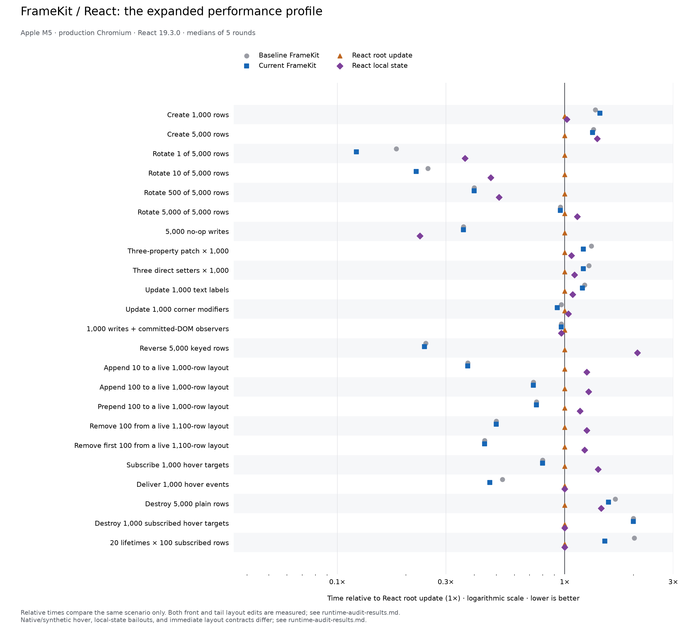

# Runtime allocation, regression, and clarity audit

Final library source: `22a2e9010be2ae3102ba4bd21f9dbc6a24d1ce31` (`22a2e90`); clean source tree.
Baseline: `2620a6a`, the previous completed construction pass. The final production matrix
uses five rounds × 21 repetitions: 105 measured samples per series, all 23 cases.

## What is worth keeping

- `25e96d0`: reuse the validated authoritative property record for unchanged writes. This avoids
  the record copy and change collections. Validation and write events still run, including
  same-value animation cancellation. Empty patches keep playback active. The focused run's
  no-op median fell 2.7 → 2.0 ms, but the final full run was 1.4 → 1.4 ms; the clear benefit is
  allocation removal, not an established universal CPU speedup.
- `4c695ff`: remove the unused property-name Set from GUI registry state. The initial render
  still receives its local Set, which can then be collected. Seven fresh-page pairs measured
  **5,352,284 → 4,354,732 bytes of added live JS heap** for 5,000 Frames: **997,552 bytes / 18.6%
  less**. DOM counts match. These are Runtime.getHeapUsage usedSize deltas after forced GC,
  excluding total process/native memory; this is the strongest quantified benefit of this pass.
- `746f1c6`: give the style factory one state-preparation path, preserving unmanaged inline
  fallback and per-instance overrides. This removes optional-state branching; no timing gain
  is claimed.
- `afafd81`: cover thrown undefined/null/false/zero values while ensuring later signal listeners
  still run. Production signals retain their existing emission snapshot and error handling.
- `22a2e90`: snapshot the working library before building and record both content hashes.
  Reports show actual median/p95 changes, dirty-source status, fixture contracts, case selection,
  and CPU throttle. Obsolete explanations of the old CSS-order change are removed. The harness
  fingerprint now includes the statistical report policy.

Properties and hierarchy edits stay synchronous. Public APIs and own property accessors are
unchanged. No additional batching, signal shortcut, or snapshot-cache state was introduced.

## Lifetime checks

The collectibility diagnostic created 50 temporary documents using all ten Frame tags, then ten
mounted 1,000-row lifetimes with layout, hover listeners, and property observers. After destruction
and explicit full GC, **all 50 documents and all 10,500 sampled handles/DOM elements were collected**.
Native listener counts returned to baseline. The live document kept exactly ten template elements,
and that count stayed flat across all lifetimes. This establishes bounded/collectible behavior
for the exercised Chromium paths, not a proof covering every application or browser.

## Final timing assessment

[Full generated timings](runtime-audit-results.md) retain all 23 cases, before/current medians,
p95 values, and both React fixtures. Raw samples are in [runtime-audit-results.json](runtime-audit-results.json).

In the final run, 22 of 23 medians were equal or lower. Creating 1,000 rows measured 6.4 → 6.7 ms
(+4.7%). Patches measured 3.8 → 3.5 ms, separate setters 3.7 → 3.5 ms, and repeated lifetimes
19.0 → 14.1 ms. Some tails increased substantially: 5,000-row construction p95 51.7 → 72.8 ms,
teardown 2.1 → 3.7 ms, and lifetimes 34.4 → 50.3 ms. These remain visible; there is no blanket
regression-free or universal CPU-speedup claim.



The earlier hover/no-op/small-append concern did not consistently reproduce. A five-round ×
51-repetition follow-up at the starting source measured hover 4.1 → 3.3 ms, no-ops 3.3 → 3.1 ms,
and small appends 0.3 → 0.3 ms, with equal append p95. Separate instrumented captures measured
hover 3.0 → 3.0 ms and append p95 0.9 → 0.8 ms. Those results do not prove zero cost or explain
all variation.

A full identical-source control uses the same case order, repetitions, and runtime isolation,
with three rounds instead of five. Before/current captured source hashes match exactly:

| Identical-source scenario          | Median A → B (ms) | p95 A → B (ms) |
| ---------------------------------- | ----------------: | -------------: |
| Create 1,000 rows                  |         6.2 → 6.2 |      7.2 → 7.3 |
| Create 5,000 rows                  |       27.1 → 27.1 |    36.1 → 35.9 |
| 5,000 no-op writes                 |         1.5 → 0.8 |      3.0 → 3.0 |
| Deliver 1,000 hover events         |         2.3 → 2.7 |      6.1 → 5.7 |
| Destroy 5,000 plain rows           |         1.4 → 1.4 |      1.8 → 1.6 |
| 20 lifetimes × 100 subscribed rows |       12.6 → 12.6 |    14.2 → 13.9 |

Zero-change no-op and hover swings are comparable to differences previously attributed to an
optimization. The larger construction/lifetime tail increases did not recur in the control,
but this does not prove that all full-matrix tails are noise. Absolute timings also varied greatly
between runs. Treat CPU differences as diagnostics; do not pool runs or select the fastest one.

The lifecycle trace establishes a GC contributor to a spike: the slowest current operation
lasted 25.511 ms and overlapped 10.307 ms of traced main-thread V8 GC. This was before the
retained-state cleanup and includes profiling overhead. CPU timestamps were non-monotonic,
so weighted CPU percentages are deliberately omitted. No leak or consistent hover regression
was established, and no dispatch change was retained to chase those measurements.

## Rejected experiments

- Caching freshly copied snapshot graphs increased lifecycle median 12.2 → 13.4 ms and 5,000-row
  construction 27.2 → 27.6 ms. Removed.
- An early hit on the existing snapshot cache showed no consistent improvement: lifetimes
  12.1 → 12.1 ms and construction 26.9 → 27.2 ms. Removed.
- Lazy signal-error arrays increased hover median 3.7 → 4.6 ms and observer writes 2.3 → 2.4 ms.
  Removed; useful failure-identity tests remain.

All focused raw runs, controls, memory samples, and compact trace windows are preserved in
[runtime-audit-diagnostics.json](runtime-audit-diagnostics.json). One-off diagnostic scripts and
full local trace paths are recorded there; those scripts are not maintained runner entry points.

## Validation and stopping point

Focused property, tween/spring, GUI construction, native/button event, signal, and style tests
passed. Chromium verified prepared-frame independence, real-frame animation interruption, and
repeated subtree cleanup. TypeScript and commit hooks passed. Every full benchmark fixture
assertion completed; summaries recompute from raw samples, source hashes verify, and before/current
compatibility observations match. The complete test/build/browser matrix remains in CI.

This pass is good enough to stop adding runtime fast paths: the retained changes reduce clear
allocation/retention costs, lifetime checks and functional contracts pass, and extra caches or
signal branches failed measurement. The code has less retained state and simpler preparation.
FrameKit still has feature/synchronous-transaction overhead versus React in several cases.
Further CPU claims need repeatable evidence under stable conditions; exact tail behavior remains
uncertain. Older [construction](construction-results.md), [text/style](followup-results.md), and
[DOM-order](regression.md) reports remain historical evidence.

To rerun the final matrix and regenerate its chart:

```sh
node benchmarks/comparison/run.mjs --baseline 2620a6a --rounds 5 --repetitions 21 --out benchmarks/comparison/runtime-audit-results.json
python3 benchmarks/comparison/plot.py benchmarks/comparison/runtime-audit-results.json --output benchmarks/comparison/runtime-audit-comparison
```

The generated timing report is separate from this interpretation, so rerunning the benchmark
preserves the investigation notes. For the full identical-source control, use baseline 22a2e90
while running that same source, with three rounds and 21 repetitions.
